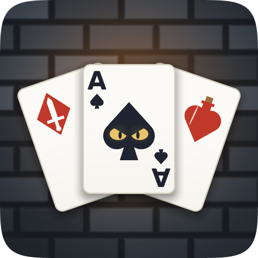
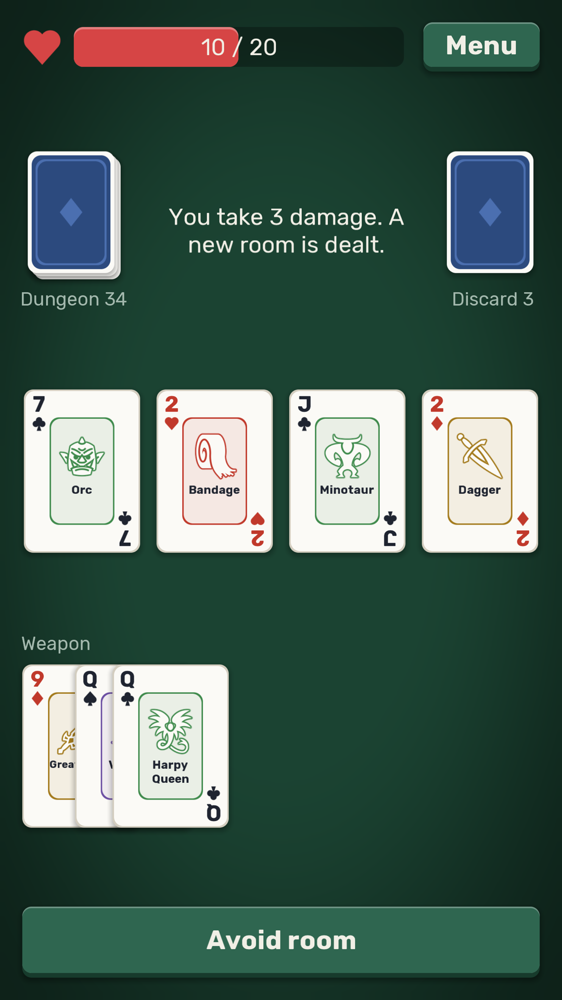
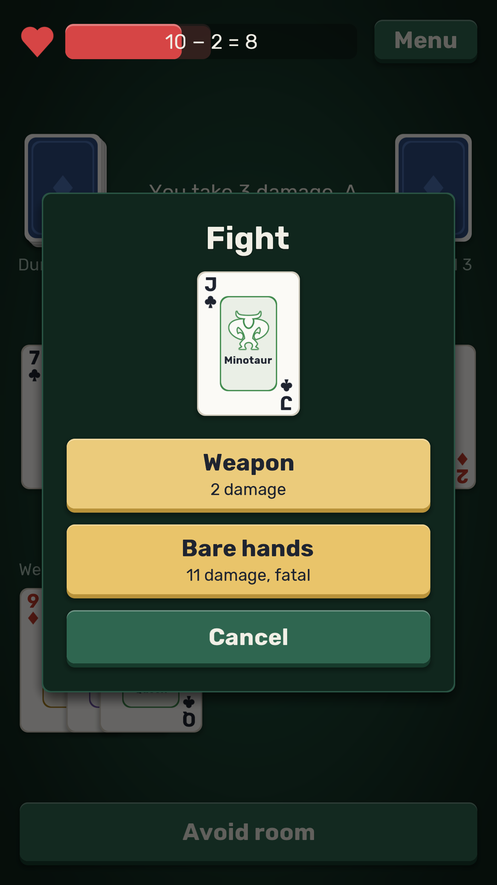
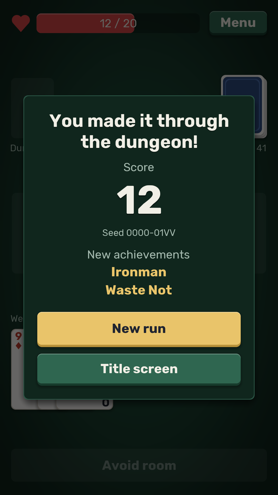

# Deckdelve

A solo roguelike dungeon crawl played with a 44-card deck. Every card is a monster, a weapon or a potion. Each room deals four cards: you resolve three, and the fourth carries into the next room.

*Based on [Scoundrel](http://www.stfj.net/art/2011/Scoundrel.pdf) by Zach Gage and Kurt Bieg.*

## About

Deckdelve is a free, open-source and fully offline version of Scoundrel. The classic rules stay faithful, and everything added on top is opt-in.

- **The classic rules**, kept as the original has them. Where the original leaves a point open, the other reading is a rule variant in Settings.
- **A tutorial** that walks through one full run, and a rulebook with its examples laid out in cards.
- **Themes.** Fantasy turns the deck into weapons, potions and two families of monsters; Classic Cards shows plain playing cards. Rank and suit always stay in the corners.
- **Eight challenge modifiers**, each with a score multiplier measured by a bot over 50,000 runs.
- **Twenty achievements** and a few stats, all kept on your device.
- **Autosave** after every action, so a run survives closing the game.
- **Seeds.** Every run ends with its seed, and a seed deals the same dungeon on every platform.
- **Fully offline:** no ads, accounts, tracking or network access.

Themes are data: a folder of names, colors and icons, with no code. [THEMES.md](THEMES.md) shows how to make one.

## Install

| Platform | Where |
|---|---|
| Web | [Play in the browser](https://orumcan.github.io/Deckdelve/), with nothing to install |
| Android | [F-Droid](https://f-droid.org/packages/io.github.orumcan.deckdelve/), once its review of the first release is through |
| Windows, macOS and Linux | The [latest release](https://github.com/orumcan/Deckdelve/releases/latest) |

The desktop zips carry their own Java, so there is nothing else to install:

- **Windows:** unzip `Deckdelve-…-windows-x64.zip` and run `Deckdelve.exe`. Windows may say it doesn't recognize the app: choose More info, then Run anyway.
- **macOS:** take `…-macos-arm64.zip` for a Mac with Apple silicon or `…-macos-x64.zip` for an Intel one. Double-click the zip and move Deckdelve to Applications. Apple hasn't notarized the app, so macOS refuses the first launch: click Done, open System Settings, go to Privacy & Security and choose Open Anyway beside Deckdelve. It only asks once.
- **Linux:** unzip `…-linux-x64.zip` and run `Deckdelve` in its folder.
- **Anything else with Java 17 or newer:** `java -jar Deckdelve-….jar`.

`SHA256SUMS.txt` in each release lists the checksums of its files.

## Building

You need JDK 21. The Gradle wrapper fetches everything else. Android builds also need the Android SDK, found through `ANDROID_HOME` or `sdk.dir` in `local.properties`.

| Task | Command |
|---|---|
| Run on desktop | `./gradlew lwjgl3:run` |
| Run in the browser | `./gradlew teavm:run`, then open the printed link |
| Build an Android APK | `./gradlew android:assembleDebug` |
| Play the text version, for testing the rules | `./gradlew -q --console=plain console:run` |
| Measure the challenge modifiers with a bot | `./gradlew -q --console=plain console:run --args='--bot 50000'` |
| Build, test and check formatting | `./gradlew build` |
| Format the code | `./gradlew spotlessApply` |

In IntelliJ IDEA or Android Studio, the `.run` folder adds Desktop, Web and Tests to the run configurations, so each is one click.

## Contributing

Bug reports, themes and fixes are welcome. [CONTRIBUTING.md](CONTRIBUTING.md) says what to know first, and everyone taking part is expected to follow the [code of conduct](.github/CODE_OF_CONDUCT.md). A security problem goes through the [security policy](.github/SECURITY.md) instead of a public issue.

## License

Copyright © 2026 [Ömür Can Güngören](https://orumcan.com/).

Deckdelve is free software, released under the [GNU General Public License v3.0 or later](LICENSE).

Scoundrel was designed by Zach Gage and Kurt Bieg. Deckdelve isn't affiliated with or endorsed by them. The font, icons, sounds and libraries Deckdelve uses are credited in [CREDITS.md](CREDITS.md).
